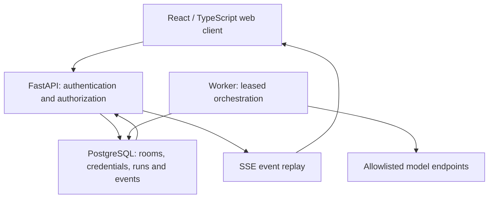
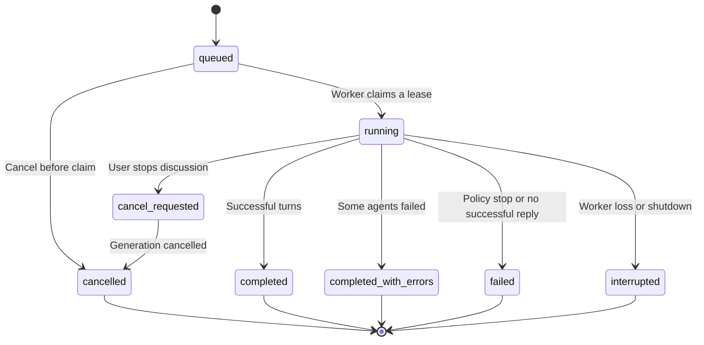

# Architecture

## Application boundaries

The browser sends messages and configuration to the application server. It never calls model providers directly or receives their saved keys. Provider adapters implement a common async chunk contract for OpenAI-compatible SSE, Ollama NDJSON, and non-streaming endpoints.

## Data ownership

A user can belong to multiple workspaces. Membership role controls access. Every room and provider connection belongs to a workspace; every resource read or mutation checks that membership. Owner-only operations include connections, invitations, roles, and audit access. Members configure rooms and start or stop discussions. Viewers can read and export.

Rooms contain ordered agents and a versioned conversation policy. Messages preserve agent name/model independently of current configuration. Runs store an immutable snapshot of room policy, agents, provider configuration (without keys), input, and bounded history. Key rotation is resolved against the connection at execution time. Run events support replay independently of the browser session.

## Execution lifecycle

A partial unique database index allows one active run per room. A unique `(room_id, request_id)` key makes retries of message submission idempotent. Workers claim queued records using a conditional update and PostgreSQL row locks. Lease heartbeats prevent another worker from taking an active run; expired work is marked interrupted and is not automatically replayed, because the previous provider request may have incurred cost.

Generation runs outside database transactions. Completed messages and replayable events are committed incrementally. Cancelling stops the generation task, stores partial text as incomplete, and emits a terminal event. The browser may disconnect without stopping a run. SSE checks session validity and workspace access while streaming.

## Discussion policies

| Policy | Behavior | Bound |
| --- | --- | --- |
| Independent replies | Up to four concurrent provider requests; each receives the same initial history | Active agents and max turns |
| Round-robin | Agents speak in configured order, receiving earlier successful replies | Rounds × active agents, capped by max turns |
| Moderator-led | Designated model returns an allowed agent ID or a stop decision | Max turns and runtime; selection adds a model call |
| Single-agent target | One selected agent replies | One turn |

A shared prompt influences goals, topic, tone, and interaction decisions. The server enforces the selected scheduling policy and limits; natural-language prompts cannot override server limits. A moderator's response is parsed and checked against enabled IDs. No arbitrary tool execution is enabled.

## Security and limits

- Scrypt password hashes; random session cookies stored as SHA-256 digests in the database.
- HttpOnly, SameSite=Strict cookies; Secure required in production; origin validation on mutations.
- Fernet authenticated encryption for provider keys. Encryption key is independent of the database.
- Exact provider hostname allowlist, HTTPS required except explicitly allowed HTTP hosts; redirects disabled; proxy environment ignored.
- Provider failure responses are sanitized, never forwarding their raw bodies to clients.
- Retries occur only before a response emits text, for connection failures or transient HTTP status codes.
- Output caps per agent; 64 maximum turns; 15-minute maximum run; bounded history count and 100,000 context characters plus the latest user topic.
- CSP and HTML escaping/Markdown rendering; raw HTML and remote Markdown images are not enabled.
- Database login throttling; production edge rate limits are still required.

Use network egress policy as a second boundary for outbound endpoints. An allowlisted hostname may resolve to a private IP; allowlists are deployment-controlled, and DNS/egress restrictions should match the organization's network policy.

## Maintainability

Routes handle HTTP and access checks. Services own state transitions and orchestration. Vendor transport is isolated in providers/client.py. Domain fields are explicitly validated by Pydantic and exposed through OpenAPI. Database schema changes use Alembic. Frontend state is split between typed transport, room hooks, and feature components; credentials never enter persistent browser state.
